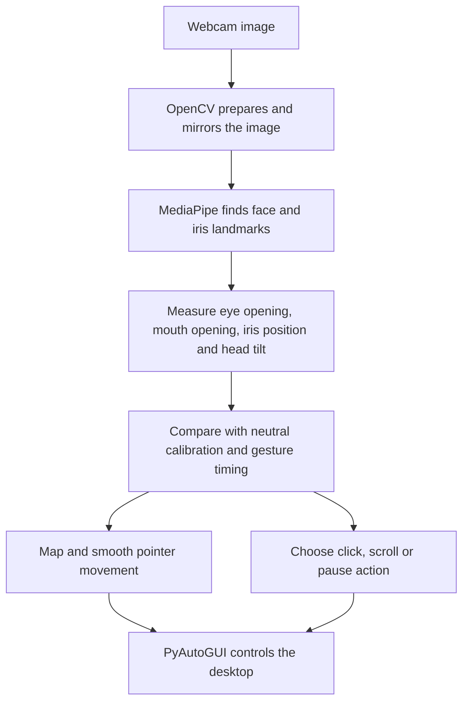

# iMouse - Eye-Controlled Mouse

iMouse is a Python desktop application that uses a webcam to turn eye and face movements into mouse actions. You can move the pointer, click with a wink, scroll by tilting your head, and pause or resume by opening your mouth.

The project explores hands-free computer interaction using an ordinary webcam. It uses a pretrained face-tracking model, so you do not need to train a model, collect a dataset, or have a dedicated graphics card.

**How movement works:** iMouse measures the position of your irises (the colored parts of your eyes) in the camera image. Small head movements help move that position and steer the pointer. It does not calculate the exact screen location you are looking at. Expect to practice the movements rather than simply look at an icon.

## Start here

For your first run, follow **What you need**, **Install and set up**, and **Try the preview first**, then enable real mouse control. The later sections explain customization, troubleshooting, and optional project evaluation.

## What you need

- A computer with a working built-in or USB webcam and a desktop display.
- **64-bit Python 3.11 or 3.12.** The dependency files target these versions; use 3.11 for the instructions below.
- Internet access to download Python and install dependencies. The controller processes webcam frames locally.
- A well-lit place where your face and both eyes are clearly visible.
- A keyboard and physical mouse available for initial setup and stopping the application.

The instructions below use **Windows PowerShell**. Run the application on your own computer: a hosted notebook such as Google Colab cannot directly control your local desktop mouse.

The repository includes automated Linux validation, but its validation notes do not establish that interactive Windows webcam control has been tested. On macOS, camera and Accessibility permissions are needed; Linux needs a compatible desktop input backend, typically X11. Those systems may require additional setup beyond this Windows guide.

## Install and set up

### 1. Open the project folder in PowerShell

If you downloaded a ZIP, extract it first. Open the **outer `iMouse` folder containing `mouse-controller.py`, `requirements.txt`, and this README**. The inner `imouse` folder contains application modules and is not the launch directory.

In File Explorer, open that folder, type `powershell` in the address bar, and press Enter.

Alternatively, use `cd` (change directory). For the folder location in this placement collection:

```powershell
cd "C:\Users\aksha\Desktop\placement\Projects\Eye Controlled Mouse- CV\iMouse"
```

If your copy is elsewhere, replace the path with your own. Keep the quotation marks because the path contains spaces.

Check that you are in the right folder:

```powershell
dir
```

You should see `mouse-controller.py` and `requirements.txt`.

### 2. Check Python

```powershell
python --version
```

Proceed if this prints Python 3.11.x or 3.12.x. Otherwise, install a 64-bit Python 3.11 or 3.12 release from the official Python website, python.org. Include pip and, if offered, the option to add Python to PATH. Close and reopen PowerShell after installation, then return to the project folder.

If you have several Python versions, you can check for a specific one with:

```powershell
py -3.11 --version
```

The `py` launcher is optional. If it says no installed Python was found but `python --version` reports a supported version, use `python` as shown below.

### 3. Create an isolated environment

A virtual environment is a local folder containing the Python interpreter and libraries for this project. It helps keep this project's package versions separate from other projects.

```powershell
python -m venv .venv
```

If `python` selects a different version but `py -3.11` works, use `py -3.11 -m venv .venv` instead.

### 4. Install the libraries

Run these commands one at a time and wait for each to finish:

```powershell
.\.venv\Scripts\python.exe -m pip install --upgrade pip
.\.venv\Scripts\python.exe -m pip install -r requirements.txt
.\.venv\Scripts\python.exe -m pip check
```

The final command should report `No broken requirements found.`

All remaining commands use the environment's Python directly. **You do not need to activate the environment**, so PowerShell script-activation restrictions do not affect these instructions.

Keep the versions in `requirements.txt`. In particular, this code needs MediaPipe's older `solutions.face_mesh` API. Also, `opencv-contrib-python` already supplies `cv2`; do not install a second OpenCV distribution into the same environment.

## Try the preview first

Preview mode, called **dry run**, recognizes gestures and displays the predicted pointer position without moving or clicking your actual desktop mouse.

```powershell
.\.venv\Scripts\python.exe mouse-controller.py --dry-run
```

1. An `iMouse` window should open with a mirrored webcam view.
2. Sit comfortably facing the camera. Keep your head in a neutral position, both eyes open, and your mouth closed.
3. Wait for the calibration counter to reach **45/45**. Calibration means learning your neutral face position and normal eye opening. It needs 45 consecutive valid frames; losing your face, closing your eyes, or opening your mouth too much resets the count.
4. After calibration, dry-run tracking activates automatically. At 30 processed frames per second, calibration takes about 1.5 seconds; slower processing takes longer.
5. Make small head movements while keeping your eyes open. A green cross in the preview shows the predicted pointer position. Try a deliberate wink and watch the event text for a left or right click.
6. With the preview window selected, press **Q** or **Esc** to stop.

The preview also shows status text, face markers, processing FPS (frames per second), and inference time (time spent finding facial landmarks). Dry run uses a virtual 1920 x 1080 screen for its predictions, which may differ from your actual display.

## Enable real mouse control

Stop the preview session, then run:

```powershell
.\.venv\Scripts\python.exe mouse-controller.py
```

Calibrate again with your head neutral, eyes open, and mouth closed. **Real desktop control starts paused after calibration.**

Click the preview with your physical mouse to give it keyboard focus, then press **Space** to enable control. Alternatively, hold your mouth open for at least **0.6 seconds**, then close it. The toggle happens once the hold time is reached; closing your mouth lets movement resume and prepares the next toggle.

Start by moving the pointer around an empty area of your desktop. Keep your head mostly upright when aiming; tilting sideways is the scroll gesture.

### Controls

| Action | What to do |
|---|---|
| Move the pointer | Make small movements that shift your eye/face position relative to the calibrated center. |
| Left click | Wink with one eye for 0.15-1.0 seconds, then reopen it. Check the preview to identify the eye mapped to left click. |
| Right click | Use the other eye for the same wink-and-release gesture. |
| Ordinary blink | Closing both eyes cancels a pending wink; it is intended to produce no click. |
| Scroll | Tilt your head sideways more than about 12 degrees from neutral and hold briefly. Opposite tilts scroll in opposite directions. Return upright to stop. |
| Pause or resume | Hold your mouth open for 0.6 seconds, then close it; or press **Space** in the preview window. |
| Recalibrate | Press **C** in the preview, then hold your neutral pose again. Desktop control pauses for recalibration and remains paused afterward until enabled. |
| Quit | Press **Q** or **Esc** in the preview, close its window, or press **Ctrl+C** in the terminal. |
| Emergency stop | Move your physical mouse to a corner of the primary screen. PyAutoGUI's corner fail-safe stops the application. |

**Keyboard shortcuts work only when the relevant window has focus.** If another application is selected, use the mouth gesture to pause, or return to the iMouse preview before using its shortcuts.

Clicks happen when you **reopen** the eye, not while you hold it closed. Holding a wink longer than one second does not produce a click. Between winks, briefly keep both eyes open so the detector can reset. The pointer holds during eye closures and scrolling to help avoid moving away from the intended target.

The webcam image is mirrored, and click mapping follows the project's landmark groups. If the buttons feel reversed, stop and restart with:

```powershell
.\.venv\Scripts\python.exe mouse-controller.py --swap-winks
```

The application controls the **primary display**. Its gesture controls provide pointer movement, single left/right clicks, and scrolling; there is no dedicated drag-and-drop gesture.

### Run it again later

Open PowerShell in the same project folder and run:

```powershell
.\.venv\Scripts\python.exe mouse-controller.py
```

You do not need to reinstall the libraries each time. Calibration is performed at the start of each session.

## Adjust the camera and movement

Stop the running session before restarting with different options. Options can be combined, including with `--dry-run`.

| Option | Default | Purpose |
|---|---|---|
| `--camera 1` | `0` | Try another camera index if the wrong webcam opens or no input is available. |
| `--gain-x 3 --gain-y 4` | `4.0`, `6.0` | Adjust horizontal and vertical sensitivity. Lower values make movement smaller; higher values make it larger. |
| `--width 480 --height 360` | `640`, `480` | Request smaller frames to reduce processing work. Smaller eye images may reduce tracking quality. |
| `--fps 30` | `30` | Request a camera frame rate; actual capture and processing rates depend on the hardware. |
| `--seconds 60` | `0` (unlimited) | Stop after approximately 60 seconds, including calibration time. |
| `--max-frames 300` | `0` (unlimited) | Stop after processing the specified number of frames. |
| `--metrics results\local_trial.csv` | Timestamped session file | Choose where to save measurements. A matching JSON summary is also written. |

For example, preview another webcam with lower pointer sensitivity:

```powershell
.\.venv\Scripts\python.exe mouse-controller.py --dry-run --camera 1 --gain-x 3 --gain-y 4
```

Show all command-line options:

```powershell
.\.venv\Scripts\python.exe mouse-controller.py --help
```

## Practice clicking targets

The project includes a small game that displays ten green targets, one at a time.

1. Start iMouse in real-control mode, complete calibration, and leave it paused.
2. Open a **second PowerShell window in the same project folder** and run:

   ```powershell
   .\.venv\Scripts\python.exe tools\target_practice.py
   ```

3. Select the target-practice window and press **Space** to begin.
4. Use the mouth gesture to enable iMouse while the target window has focus.
5. Move to each green target and use your **left-click wink**. A successful hit displays the next target; a miss increases the miss count.
6. After ten hits, the game saves its results. Use the mouth gesture to pause iMouse before closing the game. **Esc** in the target window closes that window only; quit iMouse separately.

The demo saves click positions, hit/miss outcomes, and time since each target appeared to `results/session_targets_*.csv`. It uses Tkinter, which is available with standard Python installations that include Tcl/Tk. A physical mouse can also operate the game.

## Troubleshooting

| Problem | What to check |
|---|---|
| `python` is not recognized, or opens the Microsoft Store | Install the supported Python version, enable its PATH option if offered, and reopen PowerShell. Try `py -3.11` if the launcher is available. |
| `py` reports no installed Python | Try `python --version`. If it reports 3.11 or 3.12, use `python -m venv .venv`; the launcher is not required. |
| `.venv\Scripts\python.exe` or `mouse-controller.py` cannot be found | Run `dir` and check that you are in the outer project folder. Complete environment creation first. |
| Installation says no matching distribution is available | Check that the environment uses 64-bit Python 3.11/3.12. Do not substitute Python 3.13+ for this pinned setup. If necessary, create a new environment with the supported interpreter and repeat installation. |
| `No module named cv2/mediapipe/pyautogui` | Run the requirements-install command using `.\.venv\Scripts\python.exe`, and use that same interpreter to launch the app. |
| MediaPipe has no `solutions` attribute | Reinstall from `requirements.txt` in the project environment; the required version is `mediapipe==0.10.21`. |
| Cannot open input, black image, or camera timeout | Test the webcam in your normal camera application, then close that app and other programs using it. Allow camera access for desktop apps in Windows settings. Try `--camera 1`. |
| Calibration keeps restarting or waits indefinitely | Improve lighting, face the camera, keep both eyes open and mouth closed, and keep only one face in view. Reduce glare from glasses if needed. |
| The real pointer does not move | Check whether you used `--dry-run`, which never moves it. In real-control mode, finish calibration and enable control with Space or the mouth gesture. |
| Pointer stops when your face disappears | Movement stops when tracking is lost. Return to view; tracking can resume if control was active. Press C to recalibrate if your position changed. |
| Winks do not click | Keep the other eye open, hold the wink for 0.15-1.0 seconds, then reopen. Wait briefly with both eyes open before the next wink. |
| Pointer is jumpy or moves too far | Improve lighting, steady the camera, recalibrate, and lower `--gain-x` / `--gain-y`. Leave smoothing enabled. |
| Scrolling starts while aiming | Keep your head upright. Press C and recalibrate with a comfortable neutral head angle. |
| Space, C, Q, or Esc does nothing | Select the iMouse preview window first. Keys pressed in the terminal or target-practice window have different effects. |
| Application stops with a fail-safe message | The pointer reached a screen corner. Move it away with your physical mouse and restart. |
| Target practice reports missing `tkinter` | Add Tcl/Tk support through your Python installation, then retry. |

Tracking can vary with lighting, glasses, webcam quality, face size in the image, and the ability to wink independently. This is a project prototype; the included software checks do not establish reliable performance for every user.

## How the code works

A **landmark** is a detected point on the face, such as an eye corner or iris center. The program repeats this sequence for incoming camera frames:



- **OpenCV** reads the webcam or video and draws the preview. A background reader keeps the newest camera frame so processing does not accumulate a queue of old images.
- **MediaPipe Face Mesh** detects one face and its refined eye landmarks using a pretrained model.
- **Calibration and gesture logic** compare eye opening with your neutral pose, distinguish a wink from a two-eye blink, and require gestures to last long enough before acting.
- **Pointer mapping** averages the two iris centers, measures displacement from neutral, and scales it to screen coordinates. A One Euro filter reduces small shakes while responding to larger movements.
- **PyAutoGUI** sends mouse movement, click, and scroll commands. Dry run skips desktop mouse actions entirely.

### Main dependencies

The exact versions are in [requirements.txt](requirements.txt).

| Library | Version | Role |
|---|---|---|
| MediaPipe | 0.10.21 | Face and iris landmark detection |
| OpenCV contrib | 4.11.0.86 | Camera/video input, image processing, and preview |
| NumPy | 1.26.4 | Numerical operations and measurement summaries |
| PyAutoGUI | 0.9.54 | Desktop mouse actions |
| JAX / JAXlib | 0.4.35 each | Pinned dependencies for the MediaPipe installation; not a separate training step |

## Project files

```text
iMouse/
|-- mouse-controller.py          # Start the application here
|-- requirements.txt             # Runtime libraries and versions
|-- requirements-dev.txt         # Runtime libraries plus pytest
|-- imouse/
|   |-- app.py                   # Connects camera, tracking, preview and mouse
|   |-- core.py                  # Calibration, gestures and pointer smoothing
|   |-- capture.py               # Latest-frame camera reader
|   `-- __init__.py
|-- tools/
|   |-- target_practice.py       # Interactive target-clicking demo
|   `-- validate_pipeline.py     # Optional automated pipeline checks
|-- tests/                       # Automated regression tests
|-- results/                     # Saved session and validation measurements
|-- docs/
|   |-- VALIDATION.md            # Existing test evidence and its limits
|   `-- REPORT_NOTES.md          # Method details, references and report guidance
|-- baseline/
|   `-- mouse-controller.original.py  # Archived original implementation
|-- CHANGELOG.md                 # Changes from the original implementation
`-- README.md
```

The folder also contains the original project-report PDF. Its appendix and results describe the historical version. Use the current entry point and this README to run the revised application.

## Measurements and optional evaluation

These steps are optional; they are not needed to use the webcam controller.

### Session output

After a session that starts successfully, measurements are written under `results/`:

- `session_<timestamp>.csv`: one row per processed frame, with tracking state, predicted actions, pointer coordinates, and timing measurements.
- `session_<timestamp>.json`: settings, event counts, processed FPS, and timing summaries.

CSV files can be opened in a spreadsheet application; JSON files can be opened in a text editor. The controller does not save webcam images or video. The target-practice tool writes its own CSV separately.

Event counts tell you what the software detected, **not whether the action matched your intention**. Dry-run timings do not measure operating-system mouse response. Read-to-dispatch timing starts after camera reading finishes and excludes camera sensor/driver delay and the final screen response.

### Replay a recorded video

Replace `my_recording.mp4` with a real local video path. Start the recording with a clear neutral face, both eyes open, and mouth closed long enough for calibration.

```powershell
.\.venv\Scripts\python.exe mouse-controller.py --video "my_recording.mp4" --dry-run --metrics results\local_replay.csv
```

Add `--no-preview` to process without opening a window. Both `--video` and `--no-preview` require `--dry-run`. Gesture durations use the video's frame rate; replay is processed as fast as possible rather than played at real-time speed.

### Run the automated tests

```powershell
.\.venv\Scripts\python.exe -m pip install -r requirements-dev.txt
.\.venv\Scripts\python.exe -m pytest -q
```

These tests check gesture rules, calibration, filtering, command-line validation, mouse-dispatch behavior, and camera-reader handling without requiring live webcam interaction.

To exercise actual Face Mesh inference on a generated test video:

```powershell
.\.venv\Scripts\python.exe tools\validate_pipeline.py --download-sample --output results\local_validation
```

This command downloads the public NASA astronaut image distributed by scikit-image, creates a temporary 180-frame video with face and blank sections, and writes pipeline measurements plus a validation report. The custom output name preserves the included `results/validation*` files.

The validation script also checks synthetic gestures and the library's configured mouse-call delay. These are software checks, not measurements of human gesture accuracy or live webcam latency.

### Compare performance settings

For optional experiments, restart the application with one setting changed at a time:

- `--mouse-pause 0.1` restores a 100 ms pause after each public PyAutoGUI mouse call. The normal setting is `0`.
- `--no-smoothing` disables pointer filtering.
- `--serial-camera` disables the background latest-frame reader.

Use a different `--metrics` filename for each session and keep the camera, lighting, person, and task consistent. For mouse dispatch comparisons, the JSON field `native_action_timings_ms` summarizes only frames that issued native mouse calls; `timings_ms` includes calibration and no-action frames too.

See [the validation record](docs/VALIDATION.md) for existing results and remaining interactive checks, [the changelog](CHANGELOG.md) for implementation changes, and [the report notes](docs/REPORT_NOTES.md) for method details, references, and an evaluation plan.
